<h1 align="center">Hi 👋, I'm Zubayear</h1>

<h3 align="center">
  Software Engineer · Systems Enthusiast · Open Source
</h3>

  <i>"It's all right. You'll stand up. And you'll start walking. Soon..."</i>

  

  

---

### 🐼 About Me

- 🔭 Currently building **[raven](https://github.com/Zubayear)**
- 🧠 Interested in distributed systems, concurrency, and systems programming
- 💻 I enjoy working with C, Zig, Go, Kotlin, and Java
- 🛠️ Exploring the internals of software, from low-level programming to distributed architectures
- 📂 Explore my work: [github.com/Zubayear](https://github.com/Zubayear)
- ⚡ Fun fact: **天上天下唯我独尊**

---

### 🧰 Languages & Technologies

**Languages**

  

**Databases & Messaging**

  

**Tools & Environment**

  

---

### 🚀 Featured Projects

<table>
  <tr>
    <td width="50%">
      <h3>🐦 raven</h3>
      

        Currently working on an interesting project.
      

      <a href="https://github.com/Zubayear/raven">
        View Repository →
      </a>
    </td>
  </tr>
</table>

---

### 📊 GitHub Statistics

  
  

  

---

### 🟩 Contribution Graph

  <picture>
    <source
      media="(prefers-color-scheme: dark)"
      srcset="https://raw.githubusercontent.com/Zubayear/Zubayear/output/pacman-contribution-graph-dark.svg"
    />
    <source
      media="(prefers-color-scheme: light)"
      srcset="https://raw.githubusercontent.com/Zubayear/Zubayear/output/pacman-contribution-graph.svg"
    />
    
  </picture>

---

  <i>天上天下唯我独尊</i>

  Building things, understanding systems, and enjoying the process.

